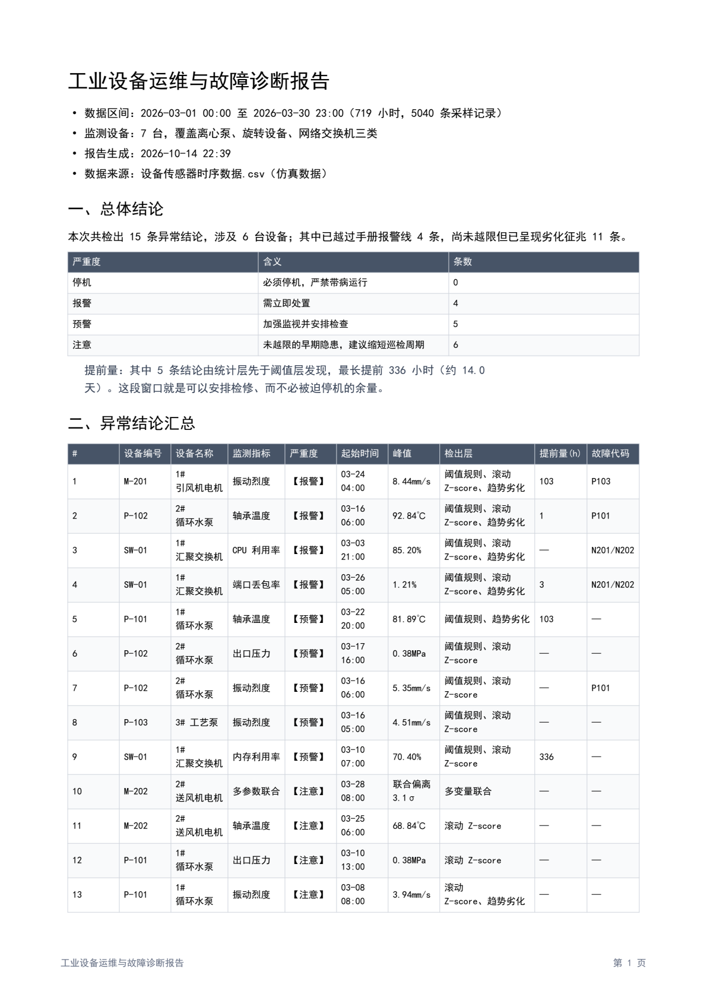
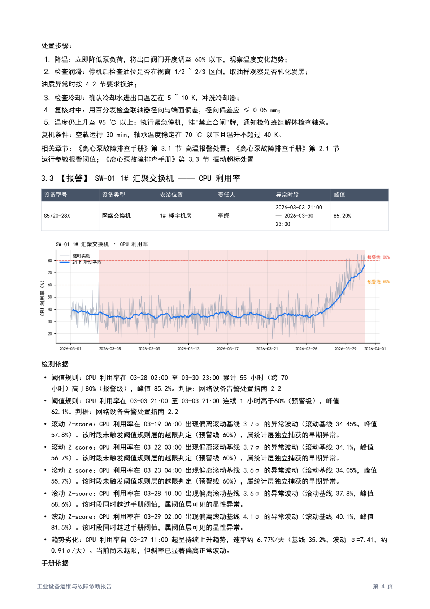

# 设备运维知识库 Agent

> **Equipment Ops KB Agent** · 基于**四层异常检测 + 运维手册 RAG + 工具调用 Agent** 的设备状态监测与故障诊断系统。
> 用自然语言提问即可定位手册章节，自动识别设备隐患，一键导出带手册依据的《设备诊断与维护建议报告》。

---

## 这个项目要解决的问题

工业现场的报警系统基本都是**单点阈值**：温度超过 85 ℃ 就响。它抓得住已经出事的设备，
抓不住还没出事的设备——而维保部门真正想提前知道的，恰恰是后者。

更麻烦的是"数据异常"和"该怎么处理"是脱节的：监测平台告诉你"1# 引风机振动 8.4 mm/s 报警"，
至于该停机还是该安排检修、要检查哪几个部位，得老师傅翻手册。这两件事本该是一次检索的距离。

本项目的回答是：**四层检测负责"提前发现"，知识库检索负责"告诉你怎么做"，Agent 负责把两者组织成能直接执行的东西。**

## 效果（内置仿真数据，30 天 × 7 台设备 × 5040 条采样）

| 指标 | 结果 |
|---|---|
| 检出结论 | 15 条 |
| 其中已越手册报警线 | 4 条 |
| **尚未越限、属早期劣化隐患** | **11 条** |
| **完全落在阈值报警盲区**（阈值层未参与检出） | **6 条** |
| 由统计层先于阈值层发现，最长提前 | 336 小时（14 天） |
| 手册引用命中率 | 15/15 |

换句话说：**如果只有传统的阈值报警，这 15 条结论里有 6 条根本不会出现**，
而这 6 条全部是尚未越限的早期劣化。提前量最长的那条，给了 14 天的检修排产窗口——
不必等到被迫停机。

## 报告预览

下图为系统导出的 PDF 报告实际页面（内置仿真数据，17 页）：

| 总体结论与异常汇总 | 逐条诊断：趋势图 + 检测依据 + 手册依据 |
|:---:|:---:|
|  |  |

## 四层异常检测

四层不是叠床架屋。每一层负责的形态，恰好是其余三层必然漏掉的。每层都有专属验证样本：

| 层 | 抓什么 | 专属验证样本 |
|---|---|---|
| **阈值规则** | 已越线的显性告警 | M-201 振动越过 7.1 mm/s 报警线 |
| **滚动 Z-score** | 越线之前、甚至始终不越线的短时突变 | P-103 温度冲高 +7.5 ℃ 但全程未达预警线 |
| **趋势劣化** | 缓慢爬升，越线只是时间问题 | P-101 轴承温度每天 +1.6 ℃，越线前 103 小时被发现 |
| **多变量联合** | 各指标单独看都正常、但同步偏移 | M-202 振动/温度/电流各偏约 1.7σ，无任何单指标越限 |

多变量层用 IsolationForest 打分、用各指标相对基线的 σ 倍数归因——
只有打分没有归因，运维不知道该查什么；只有归因没有打分，就得为每个指标手写阈值组合规则。

> 阈值全部逐条摘自手册第 2 章，未自行设定。详见 `core/diagnostics/thresholds.py`，每条都标注出处章节。

## RAG 知识库检索引擎

三份内置手册（共 42 节、63 个检索块）：

- 《离心泵故障排查手册》— 阈值表、故障代码 P101~P105、泵/电机处置流程
- 《网络设备告警处置指南》— 告警码 N201~N205、交换机指标阈值与处置
- 《旋转设备振动诊断与润滑管理规范》— ISO 10816 振动分区、故障特征频率、润滑与温升

**检索实现**（不依赖 chromadb / faiss，纯 Python + numpy，少三个依赖换来别人一键跑起来）：

- **BM25 关键词路**：精确命中 `P103`、`N201`、`CXB-350` 这类故障码与型号。
  稠密向量容易把 P101 和 P105 当成"语义相近"，BM25 不会。
- **向量语义路**：BGE-small-zh-v1.5，处理"泵发烫是怎么回事"这种口语化提问。
  手册里写的是"轴承温度过高"，字面完全不重合。
- **RRF 融合**：按**排名**而非分数融合，规避两路分数量纲不可比的问题，无需调参。

**评测结果**（`data/检索评测集.jsonl`，27 条带标注查询，标注到具体章节）：

| 检索模式 | Hit@1 | Hit@3 | Hit@5 | MRR |
|---|---|---|---|---|
| BM25 | 77.8% | 92.6% | 96.3% | 0.859 |
| 向量 | 85.2% | 88.9% | 92.6% | 0.872 |
| **混合（RRF）** | **81.5%** | **92.6%** | **100%** | **0.887** |

```bash
python scripts/eval_retrieval.py --show-detail   # 复现上表，并打印每条查询的排名
```

**手册约束检索**：诊断层已知一台设备该查哪本手册（离心泵查泵手册、交换机查网络手册），
无需在检索时才猜测。不把这条已知信息用上，就会出现"旋转设备的轴承温度"命中
《网络设备告警处置指南》光模块那一节的荒唐结果——两者都含"温度"二字，语义检索分辨不了。

## Agent 与工具

模型通过原生 tool calling 调用五个工具，而不是把检测结果硬塞进提示词：

| 工具 | 用途 |
|---|---|
| `query_manual` | 检索手册章节，返回带出处的原文 |
| `list_devices` | 设备台账 |
| `get_device_findings` | 某台设备的全部异常结论与依据 |
| `get_metric_stats` | 某指标在指定时段的真实均值/极值/变化量 |
| `get_thresholds` | 手册规定的分级报警阈值 |

**一条贯穿始终的原则：数字只能来自工具。** 模型自己去估趋势、算均值，都会错，
而且错得很像真的。所有数值由确定性代码产出，模型只负责判断"该查什么、结果意味着什么"。

## 自动生成诊断报告

一键导出 Markdown / PDF，含：

- 总体结论与严重度分布、**统计层先于阈值层的提前量**
- 异常结论汇总表（设备、指标、严重度、峰值、检出层、故障代码）
- 逐条详述：指标趋势图（标注手册阈值线与异常时段）+ 检测依据 + **检索到的手册原文与处置步骤**
- 处置排期建议表（P0~P3，按责任人分组）
- 检测方法与口径说明（含基线假设，便于人工复核）

PDF 中文字体嵌入，黑白打印不会丢信息（严重度用【报警】文字标注而非颜色）。

> **不填 API Key 也能完整使用**：检测、检索、图表、Markdown/PDF 导出全部是确定性计算。
> 模型只负责"模型综合分析"那一段与自由问答。

## 技术栈

- **界面**：Streamlit
- **检测**：Pandas / NumPy / scikit-learn（IsolationForest）
- **检索**：LangChain-Text-Splitters（标题感知分块）、jieba、sentence-transformers（BGE-small-zh-v1.5）、纯 Python BM25 + RRF
- **Agent**：LangChain Core 原生 Tool Calling，支持 OpenAI 兼容与 Anthropic 兼容两套协议
- **导出**：Matplotlib（图表）、reportlab（PDF，嵌入中文字体）
- **文档解析**：pypdfium2（PDF 文本与书签，纯 wheel，无系统级依赖）

## 快速开始

**需要 Python 3.12**（本地验证版本 3.12.2）。3.14 过新，torch / sentence-transformers 缺对应 wheel；
`core/config.py` 会在版本不合适时给出提示。

```bash
pip install -r requirements.txt

# torch 请装 CPU 版，默认 pip install torch 会拉数 GB 的 CUDA 包
pip install torch --index-url https://download.pytorch.org/whl/cpu

streamlit run app.py
```

首次运行会自动加载嵌入模型并建立索引（约 1 分钟，之后走 `.index_cache` 缓存）。
未联网时会自动降级为纯 BM25 检索，功能可用。

在左侧侧边栏填入模型服务商与 API Key 后，可额外使用「模型综合分析」与「运维问答」。

**只想跑通检测与报告，不需要模型**：

```bash
python scripts/gen_sensor_data.py     # 重新生成仿真数据（可复现，seed=42）
python scripts/eval_retrieval.py      # 检索效果评测
```

## 项目结构

```text
equipment-ops-kb-agent/
├── app.py                      # Streamlit 界面：数据概览 / 异常诊断 / 诊断报告 / 运维问答 / 知识库
├── core/
│   ├── config.py               # 路径、中文字体注册、多服务商预设、检索参数
│   ├── kb/                     # 知识库
│   │   ├── loader.py           #   Markdown / PDF 加载（PDF 优先按书签分节）
│   │   ├── chunker.py          #   标题感知分块，父子块结构
│   │   └── index.py            #   BM25 + 向量 + RRF 混合检索
│   ├── diagnostics/            # 异常检测
│   │   ├── thresholds.py       #   手册阈值表（逐条标注出处）
│   │   ├── detectors.py        #   四层检测器
│   │   └── engine.py           #   跨层合并、提前量计算、故障码关联
│   ├── agent/                  # Agent
│   │   ├── llm.py              #   双协议模型接入
│   │   ├── tools.py            #   五个工具
│   │   ├── prompts.py          #   系统提示词与结果摘要
│   │   └── runtime.py          #   工具调用循环
│   └── report/                 # 报告
│       ├── charts.py           #   趋势图与概览图
│       ├── builder.py          #   手册依据检索 + Markdown 组装
│       └── pdf.py              #   Markdown → PDF（嵌入中文字体）
├── scripts/
│   ├── gen_sensor_data.py      # 仿真数据生成（注入六种典型故障模式）
│   └── eval_retrieval.py       # 检索评测：Hit@k 与 MRR
├── data/
│   ├── manuals/                # 三份运维手册
│   ├── 设备传感器时序数据.csv    # 时序数据（5040 行）
│   ├── 设备台账.csv             # 设备台账
│   └── 检索评测集.jsonl         # 27 条带标注的检索评测查询
├── uploads/                    # 用户上传的手册（与内置手册合并建索引）
└── reports_out/                # 导出的报告与图表
```

## 使用示例

在「运维问答」页直接提问：

- 「离心泵发生汽蚀有哪些征兆」→ 检索手册给出征兆清单与章节出处
- 「P-101 最近温度涨了多少」→ 调用工具取真实数值，不靠模型估算
- 「M-202 三个参数都正常，为什么说它有隐患」→ 结合多变量层结论与规范第 5 章作答
- 「CXB-350 的额定电流是多少，超过多少要停机」→ 返回参数表与分级阈值

## 设计取舍

**为什么不用 chromadb / faiss / rank_bm25**：语料只有几百个块，纯 Python BM25 与
numpy 余弦相似度已经绰绰有余。少三个依赖，换来别人 clone 下来能直接跑起来。

**为什么阈值不写在检测代码里**：现场运维里，"阈值"和"处置步骤"必须出自同一份文件。
手册第 2.1 节写 85 ℃ 报警，检测代码就得按 85 ℃ 判，否则报告会出现"已越限"和
"该怎么处理"对不上的情况——这种报告没人敢照着执行。

**为什么检测结论的每个数字都由代码算**：模型估算的数字错得很像真的。检测、统计、
绘图、外推全部确定性计算，模型只做它擅长的部分：解释、关联、组织。

**为什么基线取序列开头 10 天**：这是**明确写在报告里的假设**，不是隐藏设定。
假定投运初期工况正常。现场部署时应改为用检修后的稳定期数据。报告给出每条结论的
基线值，便于人工复核这个假设是否成立。

## 数据与免责声明

- `data/` 下的传感器数据与设备台账均为**仿真数据**（`scripts/gen_sensor_data.py`，
  seed=42 可复现），不含任何真实设备的运行记录；手册内容为面向本项目编写的
  技术文档，非任何厂商的官方出版物。
- 本项目仅作技术能力演示，诊断结论由算法与大语言模型生成，**不构成任何检修指令
  或安全依据**。实际检修作业请以设备厂家手册与现场规程为准。
