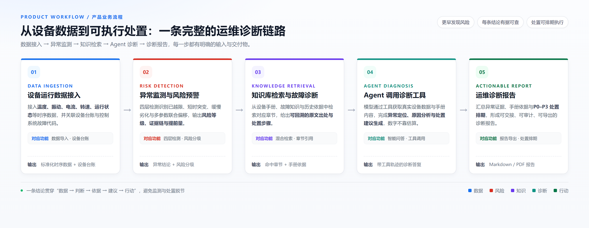
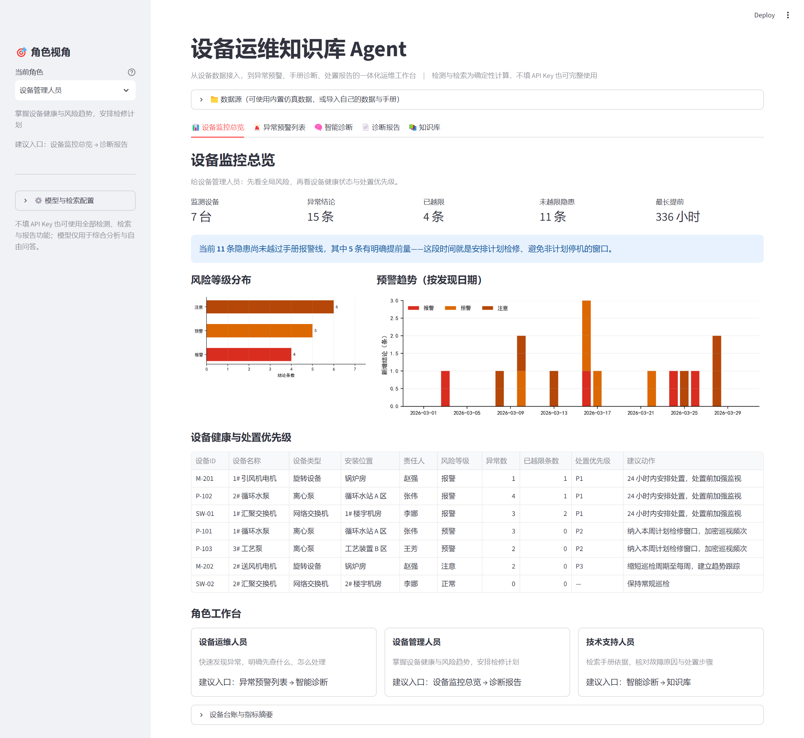
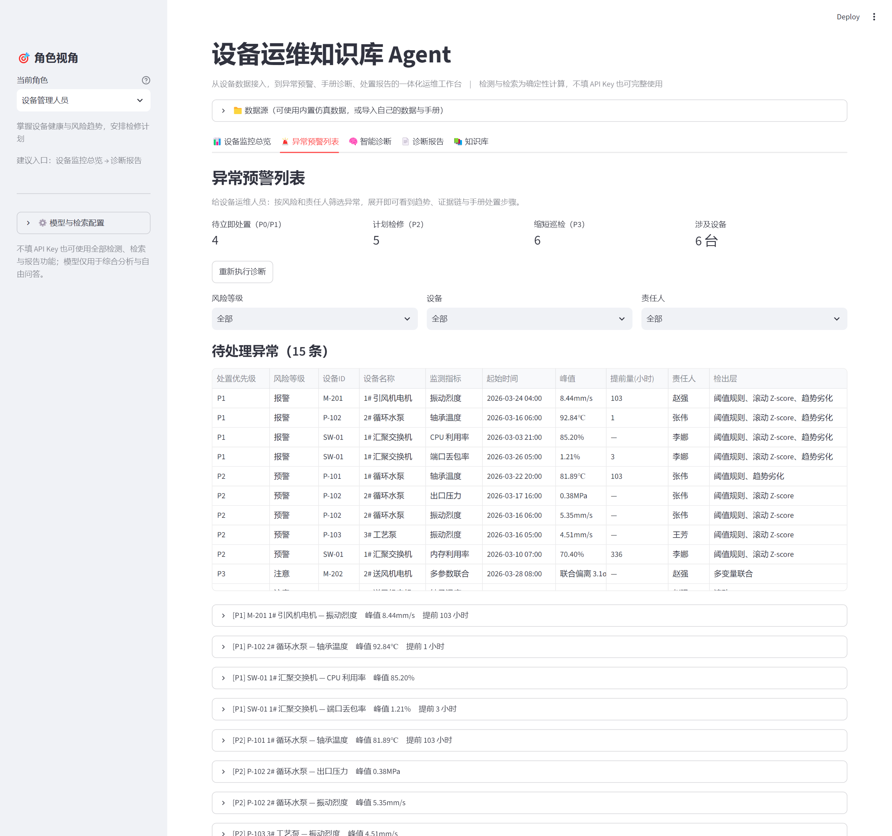
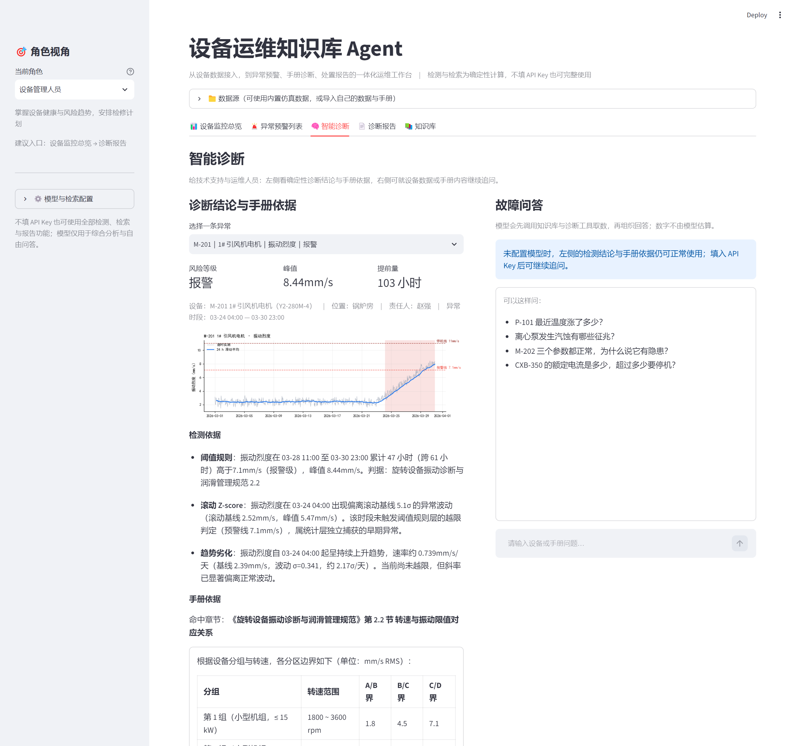
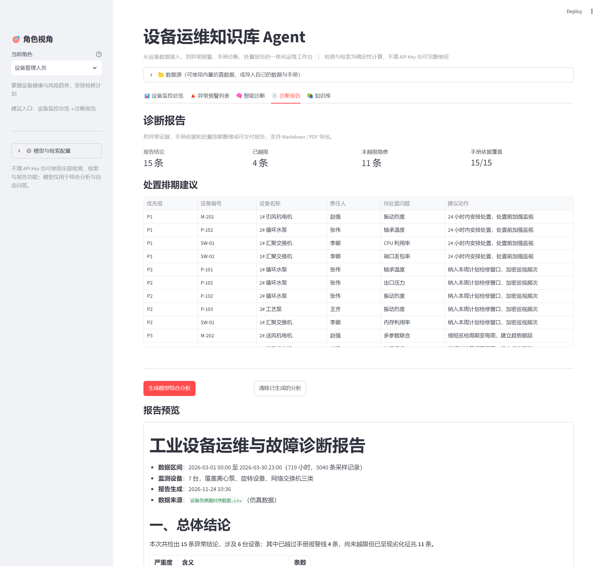

# 设备运维知识库 Agent

> **Equipment Ops KB Agent** · 面向工业设备运维的「异常预警 → 故障诊断 → 处置建议」一体化工作台。
> 不只告诉运维“哪台设备不对劲”，还告诉他们“依据哪本手册、该检查什么、什么时候处理”。



---

## 一、为什么需要这个产品

工业现场并不缺数据，也不缺报警。缺的是从“数据异常”到“处置动作”的完整链路。

| 现场断点 | 现有做法 | 造成的后果 |
|---|---|---|
| **发现断点** | 温度超过 85 ℃ 才报警，基本是单点阈值 | 缓慢爬升、短时突变、多参数同步偏移，在越限前无人看见 |
| **依据断点** | 监测平台报警后，运维再翻手册、问老师傅 | 从“发现”到“动作”依赖个人经验，交接班容易丢失上下文 |
| **闭环断点** | 结论散落在聊天记录、巡检本、个人经验里 | 处置过程难追溯，复盘和审计缺少依据 |

本项目的回答是：**四层检测负责“提前发现”，知识库检索负责“告诉你怎么做”，Agent 负责把两者组织成能直接执行的东西。**

### 验证结果（内置仿真数据：30 天 × 7 台设备 × 5040 条采样，脚本可复现）

| 指标 | 结果 |
|---|---|
| 检出结论 | 15 条 |
| 其中已越过手册报警线 | 4 条 |
| **尚未越限的 Finding** | **11 条，其中 6 条经注入真值证实** |
| **不含阈值层的 Finding**（阈值层未参与检出） | **6 条（40%），其中 4 条经真值证实** |
| **四层 vs 仅阈值：故障事件召回** | **6/6 vs 4/6，多发现 2 起故障事件** |
| **经真值校验的提前量** | **5 项，平均 45 小时，中位数 15 小时，最长 103 小时** |
| 手册依据覆盖 | 15/15 |

严格按注入故障真值核对：四层方案发现了全部 6 起故障事件，仅阈值方案只发现 4 起；完全不会被阈值层发现的两起是 **P-103 温度短时尖峰**与 **M-202 多变量隐性漂移**。不含阈值层的 6 条 Finding 中有 2 条是单点噪声，不能包装成“早期隐患”。

> 旧版本曾写“5 条提前量、平均 109 h、最长 336 h”。其中 336 h 来自 SW-01 内存利用率的早期误报（阈值层 03-24、Z-score 03-10 都早于第 25 天的注入故障），已剔除。完整口径见 [指标核对表](docs/指标核对表.md) 与 [实验报告](docs/实验报告.md)。

---

## 二、产品业务流程

| 阶段 | 输入 | 关键处理 | 输出 |
|---|---|---|---|
| **1. 设备运行数据接入** | 温度、振动、电流、转速、运行状态、故障代码、设备台账 | 数据清洗、时间对齐、设备与指标识别 | 标准化时序数据 + 设备台账 |
| **2. 异常监测与风险预警** | 时序数据 + 手册阈值 | 四层检测、跨层合并、风险分级、提前量计算 | 异常结论 + 证据链 + 风险等级 |
| **3. 知识库检索与故障诊断** | 异常结论 + 设备类型 + 指标 | BM25 + 向量 + RRF 混合检索，按设备类型限定手册 | 命中章节 + 原文 + 处置步骤 |
| **4. Agent 调用诊断工具** | 异常结论 + 手册依据 + 实时数据 | 模型通过 5 个工具取数、检索、核对 | 带工具轨迹的诊断答复 |
| **5. 运维诊断报告** | 全链路结果 | 汇总证据、排期、责任人，生成 Markdown / PDF | 可交付、可审计的诊断报告 |

**用户使用过程（端到端）**

1. **接入**：上传设备时序 CSV / Excel 与设备台账；可选上传企业自己的运维手册。
2. **扫描**：系统执行四层异常检测，按设备与指标合并结论，计算提前量并关联故障代码。
3. **查看**：进入异常预警列表，按风险等级、设备、责任人筛选；展开某条结论查看趋势图与证据链。
4. **查依据**：系统自动检索对应手册章节，展示原文与处置步骤；也可以直接在智能诊断页追问。
5. **排期**：在诊断报告页查看 P0–P3 处置排期，按责任人分组安排检修。
6. **交付**：导出 Markdown / PDF 报告，用于交接班、周会汇报或检修工单附件。

> 更完整的业务流程、角色拆解、界面原型与优先级说明见 **[产品方案](docs/产品方案.md)**。

---

## 三、目标用户与核心需求

| 用户角色 | 主要需求 | 对应功能 | 主要入口 |
|---|---|---|---|
| **设备运维人员** | 快速发现异常，知道应该检查什么 | 异常列表、设备详情、诊断问答 | 异常预警列表 → 智能诊断 |
| **设备管理人员** | 了解设备健康状态，安排维修计划 | 风险总览、预警趋势、处置排期 | 设备监控总览 → 诊断报告 |
| **技术支持人员** | 查询设备手册，获取故障排查依据 | 手册检索、故障依据、诊断报告 | 智能诊断 → 知识库 |

三个角色共用同一个工作台，角色切换只改变进入时优先展示的页面，不割裂数据和流程。

### 功能优先级

| 优先级 | 功能 | 为什么在这个优先级 | 状态 |
|---|---|---|---|
| **P0** | 数据接入与设备台账 | 没有数据就没有后续一切 | ✅ |
| **P0** | 四层异常检测与风险分级 | 产品的核心发现能力 | ✅ |
| **P0** | 异常预警列表与证据链 | 运维人员的主要工作入口 | ✅ |
| **P0** | 手册知识库与混合检索 | 让结论有依据、可追溯 | ✅ |
| **P0** | 诊断报告与处置排期 | 从“看到”走到“安排处理” | ✅ |
| **P0** | 设备监控总览 | 管理人员判断整体风险 | ✅ |
| **P1** | Agent 智能问答与工具调用 | 降低追问门槛，减少翻手册时间 | ✅ |
| **P1** | 角色视角工作台 | 不同角色先看到自己关心的页面 | ✅ |
| **P1** | 预警趋势 | 判断风险在变多还是变少 | ✅ |
| **P1** | 检索/检测/Agent 评测与结构化 Trace | 让效果可量化、执行路径可追溯 | ✅ |
| **P1** | 报告定时生成、工单导出、订阅推送 | 从报告走向工单闭环 | ⏳ |
| **P2** | 实时数据接入、CMMS/EAM 集成、权限审计、反馈闭环 | 依赖现场系统与数据积累 | ⏳ |

**MVP 定义：一份设备数据 + 一套手册 → 一份带证据和处置建议的诊断报告。** 当前 MVP 已完成，并且在不配置大模型的情况下也能跑通主流程。

---

## 四、产品界面

以下为当前可运行界面的实际截图（非静态线框图）：

| 设备监控总览：风险分布、设备健康、预警趋势 | 异常预警列表：按风险处理、展开证据链 |
|:---:|:---:|
|  |  |

| 智能诊断：诊断结论 + 手册依据 + 故障问答 | 诊断报告：处置排期 + 报告预览 + MD/PDF 导出 |
|:---:|:---:|
|  |  |

此外还有**知识库**支撑页：查看收录章节、用一线真实问题测试检索效果，并支持上传企业自己的手册。

### 报告预览

下图为系统导出的 PDF 报告实际页面（内置仿真数据，17 页）：

| 总体结论与异常汇总 | 逐条诊断：趋势图 + 检测依据 + 手册依据 |
|:---:|:---:|
|  |  |

---

## 五、业务价值与验证结果

### 检测：提前发现阈值看不见的风险

| 指标 | 结果 | 业务含义 |
|---|---|---|
| 检出结论 | 15 条 | 覆盖离心泵、旋转设备、网络交换机三类设备 |
| 已越限 | 4 条 | 需要立即或近期处置 |
| 未越限 Finding | 11 条，其中 6 条经真值证实 | 与传统阈值结论区分开 |
| 不含阈值层的 Finding | 6 条（40%），其中 4 条经真值证实 | 其中 2 条是单点噪声 |
| 四层 vs 仅阈值事件召回 | 6/6 vs 4/6 | 多发现 P-103 短时尖峰、M-202 多变量漂移 |
| 经真值校验的提前量 | 5 项，平均 45h，中位数 15h，最长 103h | 最长约 4.3 天计划检修窗口 |

评测口径、匹配规则与逐条明细见 [实验报告 · 实验 B](docs/实验报告.md#实验-b异常检测方法消融)。

### 检索：每条结论都能回到手册

内置三份手册（共 42 节、63 个检索块）：

- 《离心泵故障排查手册》— 阈值表、故障代码 P101~P105、泵/电机处置流程
- 《网络设备告警处置指南》— 告警码 N201~N205、交换机指标阈值与处置
- 《旋转设备振动诊断与润滑管理规范》— ISO 10816 振动分区、故障特征频率、润滑与温升

评测集为 27 条带标注查询，标注到具体章节。配置与结果同时写入
`experiments/results/retrieval_eval.json`（模型名、分块参数、RRF k、评测集
sha256、运行时间、逐条排名）：

| 检索模式 | Hit@1 | Hit@3 | Hit@5 | MRR |
|---|---|---|---|---|
| BM25 | 77.8% | 92.6% | 96.3% | 0.859 |
| 向量 | 85.2% | 88.9% | 92.6% | 0.872 |
| **混合（RRF）** | **81.5%** | **92.6%** | **100%** | **0.887** |

```bash
python scripts/eval_retrieval.py --show-detail   # 复现上表，并打印每条查询的排名
```

> 向量模型不可用时，脚本会把 `hybrid` 从评测方法中移除，而不是让它在
> 退化成 BM25 后与 BM25 并列，产生“混合检索无增益”的误导性表格。

### Agent：数字必须来自工具

模型通过原生 tool calling 调用五个工具，而不是把检测结果硬塞进提示词：

| 工具 | 用途 |
|---|---|
| `query_manual` | 检索手册章节，返回带出处的原文 |
| `list_devices` | 设备台账 |
| `get_device_findings` | 某台设备的全部异常结论与依据 |
| `get_metric_stats` | 某指标在指定时段的真实均值/极值/变化量 |
| `get_thresholds` | 手册规定的分级报警阈值 |

**一条贯穿始终的原则：数字只能来自工具。** 模型自己去估趋势、算均值，都会错，而且错得很像真的。所有数值由确定性代码产出，模型只负责判断“该查什么、结果意味着什么”。

**Agent 执行质量评测**：`data/agent_eval_set.jsonl` 含 40 条测试问题，覆盖设备状态查询、手册检索、异常详情、多工具组合、不存在设备、无相关手册内容、工具执行失败、精确引用检测数据八类。`scripts/eval_agent.py` 自动评分 Tool Selection / Argument、Task Success、Numeric、Evidence、Unsupported Claim，并输出失败用例。**没有配置 API Key 时不填入任何指标**，避免把 dry-run 当成 Agent 质量结论。详见 [实验报告 · 实验 C](docs/实验报告.md#实验-cagent-执行质量)。

**结构化执行记录（Trace）**：每次 Agent 运行记录 `trace_id`、问题、最终回答、轮数、模型名、总耗时、Token 用量与错误；每次工具调用记录 `step`、工具名、参数、完整返回、状态、开始时间、耗时与错误。记录以 JSONL 追加写入 `experiments/traces/agent_traces.jsonl`，可按 `trace_id` 查询或导出：

```bash
python scripts/agent_trace.py list
python scripts/agent_trace.py show <trace_id>
python scripts/agent_trace.py export <trace_id> --out experiments/traces/one.json
python scripts/agent_trace.py stats
```

---

## 六、产品如何实现（技术方案）

### 四层异常检测

四层不是叠床架屋。每一层负责的形态，恰好是其余三层必然漏掉的。每层都有专属验证样本：

| 层 | 抓什么 | 专属验证样本 |
|---|---|---|
| **阈值规则** | 已越线的显性告警 | M-201 振动越过 7.1 mm/s 报警线 |
| **滚动 Z-score** | 越线之前、甚至始终不越线的短时突变 | P-103 温度冲高 +7.5 ℃ 但全程未达预警线 |
| **趋势劣化** | 缓慢爬升，越线只是时间问题 | P-101 轴承温度每天 +1.6 ℃，越线前 103 小时被发现 |
| **多变量联合** | 各指标单独看都正常、但同步偏移 | M-202 振动/温度/电流各偏约 1.7σ，无任何单指标越限 |

多变量层用 IsolationForest 打分、用各指标相对基线的 σ 倍数归因——只有打分没有归因，运维不知道该查什么；只有归因没有打分，就得为每个指标手写阈值组合规则。

> 阈值全部逐条摘自手册第 2 章，未自行设定。详见 `core/diagnostics/thresholds.py`，每条都标注出处章节。

### RAG 知识库检索引擎

不依赖 chromadb / faiss，纯 Python + numpy，少三个依赖换来别人一键跑起来：

- **BM25 关键词路**：精确命中 `P103`、`N201`、`CXB-350` 这类故障码与型号。稠密向量容易把 P101 和 P105 当成“语义相近”，BM25 不会。
- **向量语义路**：BGE-small-zh-v1.5，处理“泵发烫是怎么回事”这种口语化提问。手册里写的是“轴承温度过高”，字面完全不重合。
- **RRF 融合**：按**排名**而非分数融合，规避两路分数量纲不可比的问题，无需调参。
- **手册约束检索**：诊断层已知一台设备该查哪本手册（离心泵查泵手册、交换机查网络手册），无需在检索时才猜测。不把这条已知信息用上，就会出现“旋转设备的轴承温度”命中《网络设备告警处置指南》光模块那一节的荒唐结果。

### 自动生成诊断报告

一键导出 Markdown / PDF，含：

- 总体结论与严重度分布、**统计层先于阈值层的提前量**
- 异常结论汇总表（设备、指标、严重度、峰值、检出层、故障代码）
- 逐条详述：指标趋势图（标注手册阈值线与异常时段）+ 检测依据 + **检索到的手册原文与处置步骤**
- 处置排期建议表（P0~P3，按责任人分组）
- 检测方法与口径说明（含基线假设，便于人工复核）

PDF 中文字体嵌入，黑白打印不会丢信息（严重度用【报警】文字标注而非颜色）。

> **不填 API Key 也能完整使用**：检测、检索、图表、Markdown/PDF 导出全部是确定性计算。模型只负责“综合分析”那一段与自由问答。

### 评测与可观测性

- **检索评测**：Hit@1/3/5、MRR，结果带完整配置与逐条排名，写入 JSON。
- **检测评测**：故障事件级、指标事件级、采样点级三套口径；四层与单层消融使用同一套检测代码，唯一变量是 `layers`。匹配按“设备 + 指标 + 时间窗”，不做 Finding 条数与故障条数的简单相除。
- **Agent 评测**：工具选择、参数、任务完成、数值、依据、无依据数值率全部程序化；LLM 不参与打分。
- **Trace**：`ToolCall` / `AgentRun` 结构化记录，JSONL 持久化，支持按 `trace_id` 查询与导出。
- **指标核对**：`scripts/audit_metrics.py` 把 README 里的每个数字重新算一遍，区分“算术成立”与“真值证实”。

### 技术栈

- **界面**：Streamlit
- **检测**：Pandas / NumPy / scikit-learn（IsolationForest）
- **检索**：LangChain-Text-Splitters（标题感知分块）、jieba、sentence-transformers（BGE-small-zh-v1.5）、纯 Python BM25 + RRF
- **Agent**：LangChain Core 原生 Tool Calling，支持 OpenAI 兼容与 Anthropic 兼容两套协议
- **导出**：Matplotlib（图表）、reportlab（PDF，嵌入中文字体）
- **文档解析**：pypdfium2（PDF 文本与书签，纯 wheel，无系统级依赖）

### 关键设计取舍

- **为什么不用 chromadb / faiss / rank_bm25**：语料只有几百个块，纯 Python BM25 与 numpy 余弦相似度已经绰绰有余。少三个依赖，换来别人 clone 下来能直接跑起来。
- **为什么阈值不写在检测代码里**：现场运维里，“阈值”和“处置步骤”必须出自同一份文件。手册第 2.1 节写 85 ℃ 报警，检测代码就得按 85 ℃ 判，否则报告会出现“已越限”和“该怎么处理”对不上的情况。
- **为什么基线取序列开头 10 天**：这是**明确写在报告里的假设**，不是隐藏设定。假定投运初期工况正常。现场部署时应改为用检修后的稳定期数据。报告给出每条结论的基线值，便于人工复核。

---

## 七、快速开始

**需要 Python 3.12**（本地验证版本 3.12.2）。3.14 过新，torch / sentence-transformers 缺对应 wheel；`core/config.py` 会在版本不合适时给出提示。

```bash
pip install -r requirements.txt

# torch 请装 CPU 版，默认 pip install torch 会拉数 GB 的 CUDA 包
pip install torch --index-url https://download.pytorch.org/whl/cpu

streamlit run app.py
```

首次运行会自动加载嵌入模型并建立索引（约 1 分钟，之后走 `.index_cache` 缓存）。未联网时会自动降级为纯 BM25 检索，功能可用。

在左侧「模型与检索配置」中填入模型服务商与 API Key 后，可额外使用「模型综合分析」与「智能诊断」中的自由问答。

**只想跑通检测与报告，不需要模型**：

```bash
python scripts/gen_sensor_data.py     # 重新生成仿真数据（可复现，seed=42）
python scripts/eval_all.py            # 一条命令跑检索评测 + 检测消融 + 指标核对
python -m unittest discover -s tests -v   # 一条命令跑单元测试
```

Agent 评测需要模型（没有 Key 时只校验测试集）：

```bash
python scripts/eval_agent.py --dry-run
set AGENT_EVAL_API_KEY=sk-...
python scripts/eval_agent.py --provider "DeepSeek（深度求索）" --model deepseek-chat
```

实验结果写入 `experiments/results/`，指标核对表为 [docs/指标核对表.md](docs/指标核对表.md)，实验报告为 [docs/实验报告.md](docs/实验报告.md)。

---

## 八、使用示例

在「智能诊断」页直接提问：

- 「离心泵发生汽蚀有哪些征兆」→ 检索手册给出征兆清单与章节出处
- 「P-101 最近温度涨了多少」→ 调用工具取真实数值，不靠模型估算
- 「M-202 三个参数都正常，为什么说它有隐患」→ 结合多变量层结论与规范第 5 章作答
- 「CXB-350 的额定电流是多少，超过多少要停机」→ 返回参数表与分级阈值

---

## 九、项目结构

```text
设备运维知识库 Agent/
├── app.py                      # Streamlit 工作台：总览 / 预警 / 诊断 / 报告 / 知识库
├── core/
│   ├── config.py               # 路径、字体、服务商预设、检索参数、Trace 路径
│   ├── kb/                     # 知识库
│   │   ├── loader.py           #   Markdown / PDF 加载（PDF 优先按书签分节）
│   │   ├── chunker.py          #   标题感知分块，父子块结构
│   │   └── index.py            #   BM25 + 向量 + RRF 混合检索
│   ├── diagnostics/            # 异常检测
│   │   ├── thresholds.py       #   手册阈值表（逐条标注出处）
│   │   ├── detectors.py        #   四层检测器（支持按层消融）
│   │   └── engine.py           #   跨层合并、提前量计算、故障码关联
│   ├── agent/                  # Agent
│   │   ├── llm.py              #   双协议模型接入
│   │   ├── tools.py            #   五个工具
│   │   ├── prompts.py          #   系统提示词与结果摘要
│   │   ├── runtime.py          #   工具调用循环 + 结构化 Trace
│   │   └── trace_store.py      #   JSONL 追加、查询、导出、统计
│   ├── evaluation/             # 评测
│   │   ├── ground_truth.py     #   六起注入故障真值
│   │   ├── matching.py         #   设备+指标+时间窗匹配、三套口径
│   │   └── agent_scoring.py    #   Agent 自动评分（不依赖 LLM 打分）
│   └── report/                 # 报告
│       ├── charts.py           #   趋势图、风险分布、预警趋势
│       ├── builder.py          #   手册依据检索 + Markdown 组装
│       └── pdf.py              #   Markdown → PDF（嵌入中文字体）
├── scripts/
│   ├── gen_sensor_data.py      # 仿真数据生成（注入六种典型故障模式）
│   ├── eval_retrieval.py       # 实验 A：检索 Hit@k / MRR
│   ├── eval_detection.py       # 实验 B：四层与单层消融
│   ├── eval_agent.py           # 实验 C：Agent 执行质量
│   ├── eval_all.py             # 一条命令跑全部实验
│   ├── audit_metrics.py        # README 指标重算与核对表生成
│   └── agent_trace.py          # Trace 查询 / 导出 / 统计
├── tests/                      # unittest：检测、检索、工具、Trace、评测
├── experiments/
│   ├── results/                # 评测 JSON 与自动生成的 Markdown 报告
│   └── traces/                 # Agent 执行记录 JSONL
├── docs/
│   ├── 产品方案.md              # 业务流程、角色、功能优先级、界面原型、指标与规划
│   ├── 实验报告.md              # 实验 A/B/C 的结果、口径与局限
│   ├── 指标核对表.md            # 自动生成的指标核对表
│   └── assets/                 # 业务流程图与源文件
├── data/
│   ├── manuals/                # 三份运维手册
│   ├── 设备传感器时序数据.csv    # 时序数据（5040 行）
│   ├── 设备台账.csv             # 设备台账
│   ├── 检索评测集.jsonl         # 27 条带标注的检索评测查询
│   ├── agent_eval_set.jsonl     # 40 条 Agent 测试问题
│   └── fault_ground_truth.json  # 注入故障真值（脚本可重建）
├── screenshots/                # 工作台截图与报告预览
├── uploads/                    # 用户上传的手册（与内置手册合并建索引）
└── reports_out/                # 导出的报告与图表
```

---

## 十、数据与免责声明

- `data/` 下的传感器数据与设备台账均为**仿真数据**（`scripts/gen_sensor_data.py`，seed=42 可复现），不含任何真实设备的运行记录；`data/fault_ground_truth.json` 是同一脚本注入故障的真值，用于检测评测；手册内容为面向本项目编写的技术文档，非任何厂商的官方出版物。
- `data/agent_eval_set.jsonl` 是针对内置数据编写的 Agent 测试问题；没有配置模型 API Key 时不会产生 Agent 质量指标，实验 C 保持空白。
- 本项目仅作产品与技术能力演示，诊断结论由算法与大语言模型生成，**不构成任何检修指令或安全依据**。实际检修作业请以设备厂家手册与现场规程为准。
