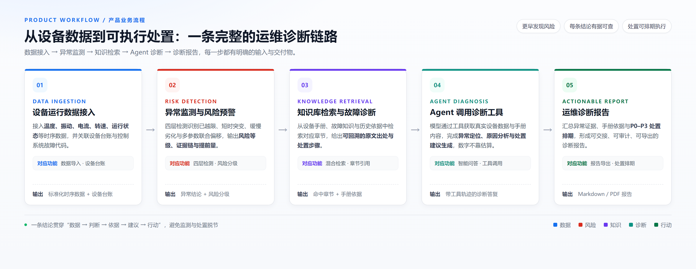
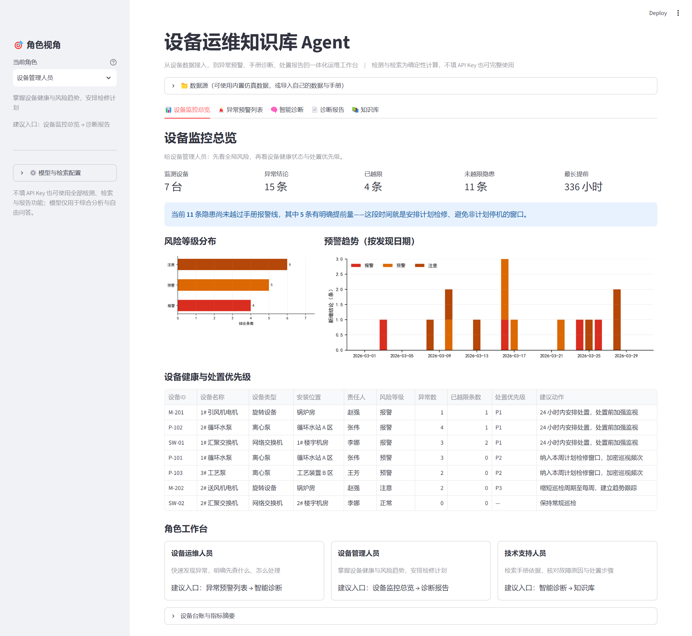
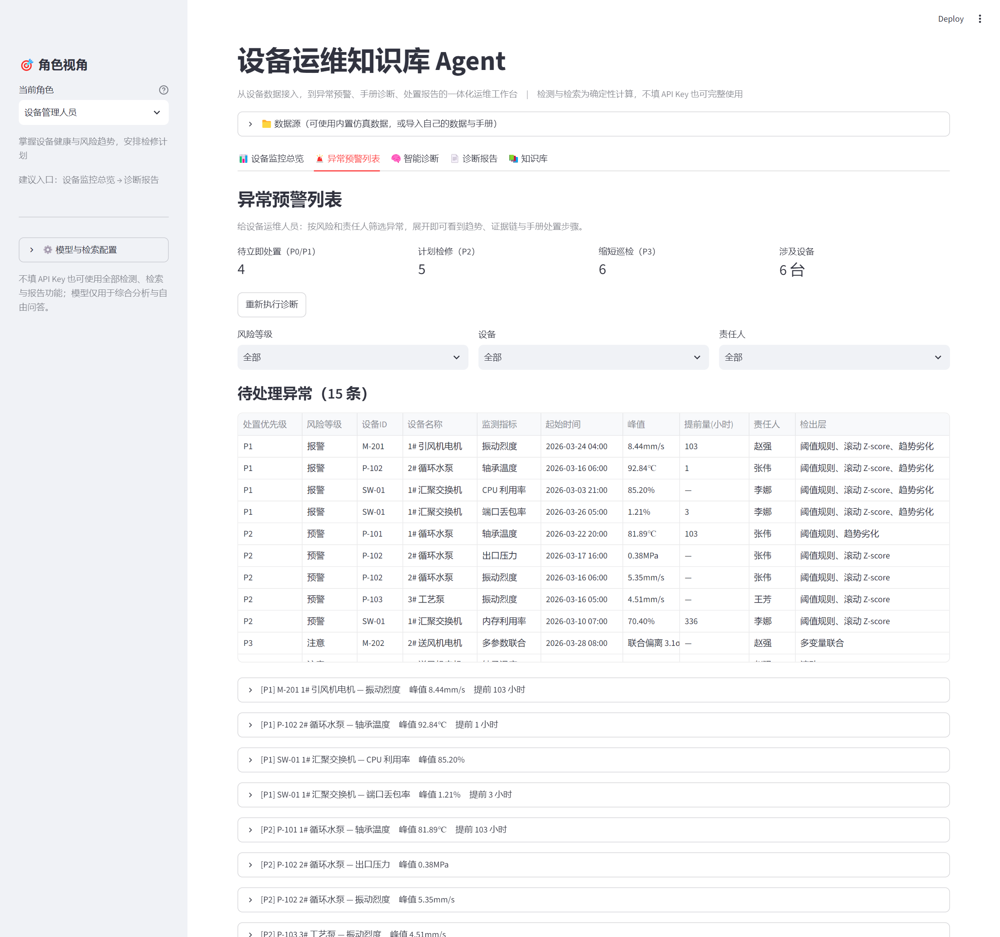
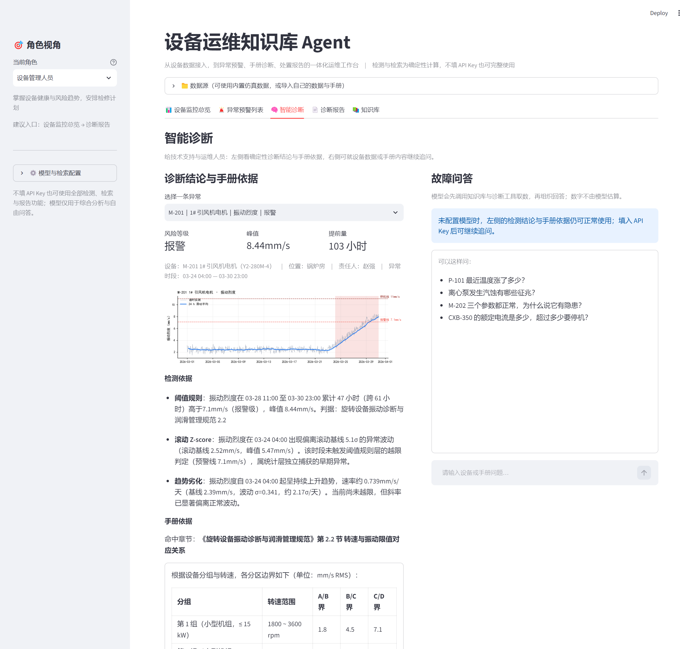
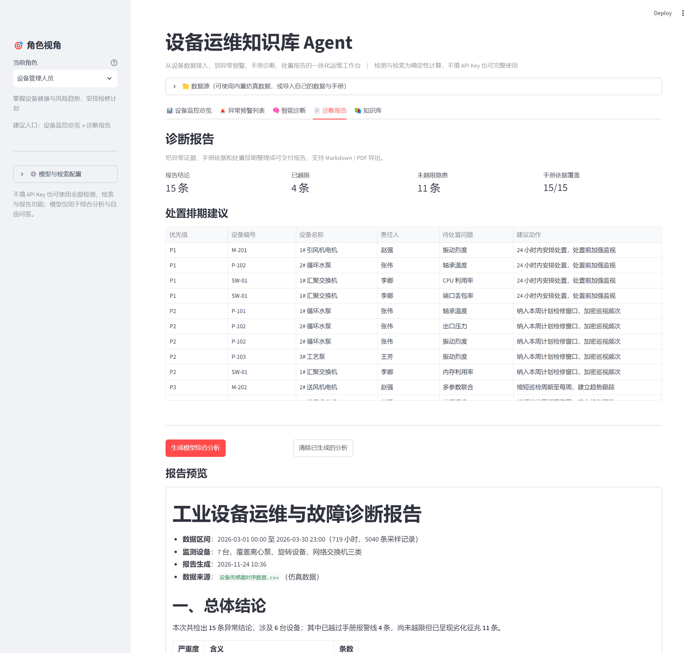

# 设备运维知识库 Agent · 产品方案

> 面向产品、业务与面试沟通的完整方案文档。技术实现、复现方式与评测细节见 [项目 README](../README.md)。

---

## 一页纸

| 项目 | 内容 |
|---|---|
| **产品定位** | 面向工业设备运维的「异常预警 → 故障诊断 → 处置建议」一体化工作台 |
| **核心用户** | 设备运维人员、设备管理人员、技术支持人员 |
| **要解决的问题** | 单点阈值抓不住早期劣化；报警与处置脱节；诊断依据难追溯 |
| **产品链路** | 数据接入 → 异常监测 → 知识检索 → Agent 诊断 → 诊断报告 |
| **核心差异** | 不只告诉用户“哪台设备不对”，还给出“依据哪本手册、该查什么、什么时候处理” |
| **当前验证** | 15 条结论；四层事件召回 6/6 vs 仅阈值 4/6；最长经真值校验提前 103 小时；手册依据覆盖 15/15 |
| **产品阶段** | MVP 已可运行：数据导入、四层检测、混合检索、Agent 问答、报告导出全链路打通 |

---

## 1. 产品定位

### 1.1 一句话定位

**把设备运行数据、运维手册和诊断流程串成一条可执行链路**：系统先发现异常，再找到手册依据，最后由 Agent 组织成一份运维人员敢照着执行的诊断报告。

### 1.2 产品形态

- **Web 工作台**：设备监控总览、异常预警列表、智能诊断、诊断报告、知识库。
- **可交付报告**：Markdown / PDF，包含异常证据、手册原文、处置步骤与 P0–P3 排期建议。
- **可配置知识库**：内置三份手册，也支持上传企业自己的 PDF / Markdown / TXT 手册。

### 1.3 产品边界

| 做什么 | 不做什么 |
|---|---|
| 从设备时序数据中发现异常并分级 | 不替代 DCS / SCADA 的实时控制与联锁 |
| 为每条结论检索手册依据与处置步骤 | 不直接向设备下发停机指令 |
| 生成带证据链和排期建议的诊断报告 | 不替代现场点检、检修作业与安全规程 |
| 支持运维人员追问设备数据与手册问题 | 不承诺模型判断 100% 正确，结论需人工复核 |

> 产品定位是**运维决策辅助工具**，不是“自动检修机器人”。所有结论都保留数据依据与手册出处，便于人工复核和审计。

### 1.4 与常见方案的区别

| 方案 | 能做什么 | 缺什么 |
|---|---|---|
| 传统阈值报警 | 抓住已经越限的显性故障 | 抓不住早期劣化、短时突变、多参数同步偏移 |
| BI / 监控大屏 | 展示曲线和报警数量 | 不告诉你该查哪本手册、下一步做什么 |
| 通用文档问答 | 能回答手册里的问题 | 不知道这台设备当前的数据和异常结论 |
| **本产品** | 检测 + 知识 + Agent + 报告串成闭环 | 需要现场数据质量与手册维护作为前提 |

---

## 2. 为什么需要这个产品

### 2.1 现场的三个断点

| 断点 | 现场现状 | 造成的后果 |
|---|---|---|
| **发现断点** | 报警系统基本是单点阈值：温度超过 85 ℃ 才响 | 缓慢爬升、短时突变、多参数同步偏移，往往在越限前无人看见 |
| **依据断点** | 监测平台说“1# 引风机振动 8.4 mm/s 报警”，该停机还是检修、查哪几个部位，要老师傅翻手册 | 从“发现异常”到“采取动作”依赖个人经验，交接班容易丢失上下文 |
| **闭环断点** | 结论散落在聊天记录、巡检本、个人经验里 | 处置过程难追溯，复盘和审计缺少依据，同类问题反复发生 |

### 2.2 现有方案为什么不够

- **只加阈值**：阈值越灵敏，误报越多；阈值越保守，早期风险越容易漏掉。单点阈值无法同时解决“漏报”和“误报”。
- **只做看板**：看板能告诉你曲线在涨，但不能告诉你“这台设备的这个指标，手册规定的处置步骤是什么”。
- **只做问答**：通用问答能回答手册问题，但它不知道这台设备当前的真实数据，容易给出“正确但不对症”的建议。

### 2.3 产品机会

把三件事接起来：

1. **多层检测补“发现”**：阈值、滚动 Z-score、趋势劣化、多变量联合四层互补，覆盖不同异常形态。
2. **手册 RAG 补“依据”**：每条结论自动检索对应手册章节，给出可回溯的原文与处置步骤。
3. **Agent + 报告补“闭环”**：模型调用工具获取真实数据，组织成带证据链、责任人和排期建议的报告。

### 2.4 已量化的验证结果

内置仿真数据：30 天 × 7 台设备 × 5040 条采样。

| 指标 | 结果 | 业务含义 |
|---|---|---|
| 检出结论 | 15 条 | 覆盖离心泵、旋转设备、网络交换机三类设备 |
| 已越过手册报警线 | 4 条 | 需要立即或近期处置 |
| 尚未越限的 Finding | 11 条（6 条经真值证实） | 与传统阈值结论区分开 |
| 不含阈值层的 Finding | 6 条（4 条经真值证实） | 其中 2 条是单点噪声 |
| 故障事件召回（四层 / 仅阈值） | 6/6 / 4/6 | 多发现 P-103 短时尖峰、M-202 多变量漂移 |
| 经真值校验的提前量 | 5 项 | 平均 45 小时，中位数 15 小时，最长 **103 小时** |
| 手册依据覆盖 | 15/15 | 每条结论都能回到具体手册章节 |

这组数字说明的不是“模型很准”，而是：**同一批数据，换一种检测与组织方式，可以把阈值层完全漏掉的 2 起故障事件提前纳入视野，并给出可执行的处置依据。**

---

## 3. 目标用户与角色

### 3.1 角色定义

| 用户角色 | 典型场景 | 核心任务 | 关键痛点 | 成功标准 |
|---|---|---|---|---|
| **设备运维人员** | 交接班、日常巡检、报警处置 | 快速发现异常，知道先检查什么 | 报警多、优先级不清；处置依赖老师傅经验 | 5 分钟内定位当天 P1 异常，并拿到检查步骤 |
| **设备管理人员** | 周会、月度检修计划、年度预算 | 掌握设备健康状态，安排检修资源 | 看不到风险趋势；排期靠经验，缺少依据 | 每周一次风险复盘，P1/P2 排期有数据支撑 |
| **技术支持人员** | 现场电话、远程支持、故障复盘 | 查手册、核对故障原因、给出处理建议 | 手册分散、检索慢；答复缺少出处 | 一次检索命中章节，答复带原文出处 |

### 3.2 需求拆解

| 角色 | 一级需求 | 二级需求 | 对应功能 | 对应界面 |
|---|---|---|---|---|
| 设备运维人员 | 快速发现异常 | 按风险排序的异常列表 | 异常预警列表 | 异常预警列表 |
| | 知道检查什么 | 趋势图、检测依据、手册步骤 | 设备详情与手册依据 | 异常预警列表 / 智能诊断 |
| | 现场追问 | 用自然语言问设备数据或手册 | Agent 问答与工具调用 | 智能诊断 |
| 设备管理人员 | 掌握全局 | 设备健康、风险分布、预警趋势 | 监控总览 | 设备监控总览 |
| | 安排检修 | P0–P3 排期、责任人分组 | 处置排期建议 | 诊断报告 |
| | 复盘汇报 | 可导出的诊断报告 | Markdown / PDF 导出 | 诊断报告 |
| 技术支持人员 | 查手册 | 关键词 + 语义混合检索 | 知识库检索 | 知识库 |
| | 核对依据 | 命中章节、原文、相关章节 | 手册依据展示 | 智能诊断 / 知识库 |
| | 形成结论 | 证据链 + 故障代码 + 建议动作 | 诊断报告 | 诊断报告 |

### 3.3 角色优先级与设计原则

- **运维人员是高频核心用户**：产品首先要在交接班和报警处置场景里“能用、好用”。
- **管理人员是推动者**：他们决定是否采购和推广，需要看到风险趋势、排期依据和可汇报的报告。
- **技术支持是深度用户**：他们决定知识库是否可信，需要看到原文、出处和检索效果。

设计原则：**一线先能用，管理能看全，技术能查深。** 因此产品用一个工作台承载三类角色，而不是做三个割裂的系统。

---

## 4. 产品业务流程



### 4.1 五个阶段

| 阶段 | 输入 | 关键处理 | 输出 | 用户价值 |
|---|---|---|---|---|
| **1. 设备运行数据接入** | 温度、振动、电流、转速、运行状态、故障代码、设备台账 | 数据清洗、时间对齐、设备与指标识别 | 标准化时序数据 + 设备台账 | 把分散的数据变成可分析的数据资产 |
| **2. 异常监测与风险预警** | 时序数据 + 手册阈值 | 四层检测、跨层合并、风险分级、提前量计算 | 异常结论 + 证据链 + 风险等级 | 在越限前发现风险，并按紧急程度排序 |
| **3. 知识库检索与故障诊断** | 异常结论 + 设备类型 + 指标 | BM25 + 向量 + RRF 混合检索，按设备类型限定手册 | 命中章节 + 原文 + 处置步骤 | 每条结论都有可回溯的手册依据 |
| **4. Agent 调用诊断工具** | 异常结论 + 手册依据 + 实时数据 | 模型通过 5 个工具取数、检索、核对 | 带工具轨迹的诊断答复 | 用自然语言追问，数字来自工具而非估算 |
| **5. 运维诊断报告** | 全链路结果 | 汇总证据、排期、责任人，生成 Markdown / PDF | 可交付、可审计的诊断报告 | 从“发现问题”走到“安排处理” |

### 4.2 用户使用过程（端到端）

1. **接入**：上传设备时序 CSV / Excel 与设备台账；可选上传企业自己的运维手册。
2. **扫描**：系统执行四层异常检测，按设备与指标合并结论，计算提前量并关联故障代码。
3. **查看**：进入异常预警列表，按风险等级、设备、责任人筛选；展开某条结论查看趋势图与证据链。
4. **查依据**：系统自动检索对应手册章节，展示原文与处置步骤；也可以直接在智能诊断页追问。
5. **排期**：在诊断报告页查看 P0–P3 处置排期，按责任人分组安排检修。
6. **交付**：导出 Markdown / PDF 报告，用于交接班、周会汇报或检修工单附件。

### 4.3 关键设计原则

- **一条结论必须同时有“数据依据”和“手册依据”**：只有数据，运维会问“凭什么这么判”；只有手册，运维会问“我这台到底有没有事”。
- **数字只能来自工具**：模型不自己估算均值、趋势和峰值；所有数值由确定性代码产出，模型只负责解释与组织。
- **没有 API Key 也能完成主流程**：检测、检索、图表、报告导出全部是确定性计算，模型是增强项而不是单点依赖。
- **报告是最终交付物**：界面负责探索，报告负责交接、审计和行动。

---

## 5. 功能架构与优先级

### 5.1 功能架构

```text
应用层
├── 设备监控总览        风险分布 / 设备健康 / 预警趋势
├── 异常预警列表        风险排序 / 筛选 / 证据链 / 手册步骤
├── 智能诊断            诊断结论 / 手册依据 / Agent 问答
├── 诊断报告            处置排期 / 报告预览 / Markdown / PDF
└── 知识库              章节目录 / 检索测试 / 手册上传

能力层
├── 异常检测            阈值规则 / 滚动 Z-score / 趋势劣化 / 多变量联合
├── 知识检索            BM25 / 向量 / RRF 融合 / 手册约束检索
├── Agent               工具调用 / 数据取数 / 结果组织
└── 报告生成            证据链 / 排期 / 图表 / PDF 排版

数据层
├── 设备时序数据        温度 / 振动 / 电流 / 转速 / 运行状态
├── 设备台账            型号 / 位置 / 责任人
├── 运维手册            PDF / Markdown / TXT
└── 评测集              带标注的检索查询
```

### 5.2 角色—功能矩阵

● 主要使用　○ 次要使用

| 功能 | 设备运维人员 | 设备管理人员 | 技术支持人员 |
|---|:---:|:---:|:---:|
| 设备监控总览 | ○ | ● | ○ |
| 异常预警列表 | ● | ○ | ○ |
| 设备详情与证据链 | ● | ○ | ● |
| 智能诊断问答 | ● | ○ | ● |
| 风险趋势与处置排期 | ○ | ● | ○ |
| 诊断报告 | ○ | ● | ● |
| 知识库检索 | ○ | ○ | ● |
| 数据与手册上传 | ○ | ○ | ● |

### 5.3 功能优先级

| 优先级 | 功能 | 用户价值 | 当前状态 |
|---|---|---|---|
| **P0** | 多源数据接入与设备台账 | 没有数据就没有后续一切 | ✅ 已完成 |
| **P0** | 四层异常检测与风险分级 | 产品的核心发现能力 | ✅ 已完成 |
| **P0** | 异常预警列表与证据链 | 运维人员的主要工作入口 | ✅ 已完成 |
| **P0** | 手册知识库与混合检索 | 让结论有依据、可追溯 | ✅ 已完成 |
| **P0** | 诊断报告与处置排期 | 从“看到”走到“安排处理” | ✅ 已完成 |
| **P0** | 设备监控总览 | 管理人员判断整体风险 | ✅ 已完成 |
| **P1** | Agent 智能问答与工具调用 | 降低追问门槛，减少翻手册时间 | ✅ 已完成 |
| **P1** | 角色视角工作台 | 不同角色进入时先看到自己关心的页面 | ✅ 已完成 |
| **P1** | 预警趋势 | 判断风险在变多还是变少 | ✅ 已完成 |
| **P1** | 知识库上传与检索评测 | 让企业自己的手册可接入、效果可量化 | ✅ 已完成 |
| **P1** | 检测消融与 Agent 质量评测 | 让“四层比阈值强多少”“Agent 答得准不准”可量化 | ✅ 已完成 |
| **P1** | 结构化 Trace 与执行记录 | 回答可追溯、失败可复现 | ✅ 已完成 |
| **P1** | 报告定时生成与订阅推送 | 周报/日报自动化，减少人工整理 | ⏳ 待开发 |
| **P1** | 处置状态标记与工单导出 | 从报告走向工单闭环 | ⏳ 待开发 |
| **P2** | 实时数据接入（OPC UA / MQTT / Kafka） | 从离线 CSV 走向在线监测 | ⏳ 待开发 |
| **P2** | CMMS / EAM 工单系统集成 | 处置动作进入企业现有流程 | ⏳ 待开发 |
| **P2** | 多租户、权限与审计 | 支撑多厂区/多角色正式上线 | ⏳ 待开发 |
| **P2** | 模型反馈闭环与阈值校准 | 用处置结果反过来优化检测 | ⏳ 待开发 |
| **P2** | 预测性维护 / 剩余寿命估计 | 从“提前发现”走向“预测剩余时间” | ⏳ 待开发 |

### 5.4 为什么这样排

- **P0 是闭环的必要条件**：数据、检测、列表、依据、报告，缺任何一环，产品都无法交付完整价值。
- **P1 提升使用频率与角色契合度**：问答、趋势、角色视角让产品从“能用”变成“好用”，可以在试点中验证。
- **P2 依赖外部系统或数据积累**：实时接入、工单集成、权限审计、反馈闭环都需要现场配合，不适合在 MVP 阶段堆上去。

### 5.5 MVP 定义

**MVP = 一份设备数据 + 一套手册 → 一份带证据和处置建议的诊断报告。**

当前 MVP 已完成，并且在不配置大模型的情况下也能跑通主流程；模型只增强“综合分析与自由问答”。

---

## 6. 核心界面原型

以下为当前可运行界面的实际截图，不是静态线框图。四个界面分别对应四类核心任务。

### 6.1 设备监控总览

**目标用户**：设备管理人员　**页面目标**：5 秒内判断“整体风险有多大、风险集中在哪、该先安排谁”。



```text
┌ 设备监控总览 ────────────────────────────────────────────────┐
│ 角色视角：设备管理人员            [模型与检索配置]            │
│ [监测设备 7] [异常 15] [已越限 4] [未越限 11] [最长提前 103h] │
│ ┌ 风险分布 ──────┐   ┌ 预警趋势（按发现日期）──────────────┐ │
│ │ 报警 4         │   │ 堆叠柱：停机 / 报警 / 预警 / 注意    │ │
│ │ 预警 5         │   │ 看清风险是集中爆发还是持续出现       │ │
│ │ 注意 6         │   └──────────────────────────────────────┘ │
│ └────────────────┘                                            │
│ 设备健康与处置优先级：设备 / 风险 / 异常数 / 已越限 / P 级 / 动作│
│ 角色工作台：运维入口 | 管理入口 | 技术支持入口                  │
└───────────────────────────────────────────────────────────────┘
```

**关键交互**

- 角色切换后，进入工作台时优先展示该角色关心的页面。
- 设备健康表按最高风险排序，直接看到责任人、异常数与建议动作。
- 风险分布与预警趋势并排，回答“现在多严重”和“在变好还是变坏”。

**空状态 / 异常状态**

- 无异常：风险分布显示“未检出异常”，设备健康表全部为“正常”。
- 数据读取失败：提示具体错误并停止，不生成空报告。
- 未配置模型：页面顶部说明检测与检索仍可正常使用。

---

### 6.2 异常预警列表

**目标用户**：设备运维人员　**页面目标**：按优先级处理异常，展开即知“哪里不对、凭什么、怎么处理”。



```text
┌ 异常预警列表 ─────────────────────────────────────────────────┐
│ [待立即处置（P0/P1）4] [计划检修（P2）5] [缩短巡检（P3）6]     │
│ [涉及设备 6 台]                              [重新执行诊断]   │
│ 筛选：风险等级 ▾   设备 ▾   责任人 ▾                          │
│ 表格：P级 / 风险 / 设备 / 指标 / 起始时间 / 峰值 / 提前量 / 责任人│
│ ▸ [P1] M-201 1#引风机电机 — 振动烈度  峰值 8.44mm/s  提前103h │
│    └ 展开：趋势图 + 检测依据 + 故障代码 + 手册原文 + 建议动作  │
└───────────────────────────────────────────────────────────────┘
```

**关键交互**

- 按风险等级、设备、责任人三重筛选，快速收敛到“我今天要处理的”。
- 展开单条结论：趋势图标出手册报警线，检测依据按层展开，手册依据给出章节与处置步骤。
- 每条结论直接给出 P 级与建议动作，避免“看到了但不知道下一步”。

**空状态 / 异常状态**

- 筛选结果为空：明确提示“当前筛选条件下没有异常结论”，不显示空白表格。
- 手册未命中：提示“未检索到对应章节，请人工查阅手册”，不编造依据。
- 提前量缺失：显示“—”，不显示 `None` 或空白歧义。

---

### 6.3 智能诊断

**目标用户**：技术支持人员、设备运维人员　**页面目标**：把“设备数据”和“手册知识”放在同一屏，支持追问与核对。



```text
┌ 智能诊断 ─────────────────────────────────────────────────────┐
│ 左：诊断结论与手册依据              │ 右：故障问答             │
│ 选择异常 ▾                          │ ┌ 对话区 ─────────────┐ │
│ 风险 报警 | 峰值 8.44 | 提前 103h  │ │ 用户问题             │ │
│ 趋势图（含手册阈值线与异常时段）    │ │ 助手回答             │ │
│ 检测依据（阈值 / Z-score / 趋势）   │ │ 工具调用轨迹         │ │
│ 手册依据（章节 + 原文 + 步骤）      │ └─────────────────────┘ │
│ 建议动作                            │ [输入框]（未配置时禁用）│
└───────────────────────────────────────────────────────────────┘
```

**关键交互**

- 左侧选择一条异常，立即看到检测结论、趋势图、证据链与手册原文。
- 右侧用自然语言追问，例如“P-101 最近温度涨了多少”“汽蚀有哪些征兆”。
- 模型调用工具取数，界面展示工具调用轨迹，回答中的数字可回溯。
- 未配置 API Key 时，左侧确定性结果仍可用，右侧输入框禁用并说明原因。

**设计考虑**

- 把“结论”和“问答”放在同一屏，避免用户在多个页面之间来回切换。
- 问答区不是唯一入口：即使不配置模型，技术人员也能完成“查依据”的核心任务。

---

### 6.4 诊断报告

**目标用户**：设备管理人员、技术支持人员　**页面目标**：把检测结果整理成可交接、可排期、可导出的报告。



```text
┌ 诊断报告 ─────────────────────────────────────────────────────┐
│ [报告结论 15] [已越限 4] [未越限 11] [手册依据覆盖 15/15]     │
│ 处置排期建议：P级 / 设备 / 责任人 / 待处置问题 / 建议动作      │
│ [生成模型综合分析]  [清除已生成的分析]                        │
│ 报告预览（Markdown 渲染）                                     │
│ [下载 Markdown 报告]  [生成 PDF 报告]  [下载 PDF 报告]        │
└───────────────────────────────────────────────────────────────┘
```

**关键交互**

- 先看排期：按 P0–P3 和责任人对齐，便于周会直接分工。
- 可选生成“模型综合分析”，作为报告的总体解读；不生成也不影响报告完整性。
- 支持 Markdown 与 PDF 两种交付格式；PDF 中文字体嵌入，黑白打印不丢信息。

**空状态 / 异常状态**

- 无异常：提示无需排期，不生成空报告。
- 未配置模型：仍可预览、下载完整检测报告。
- PDF 生成失败：页面给出错误信息，不影响 Markdown 下载。

---

### 6.5 知识库（支撑页）

**目标用户**：技术支持人员　**页面目标**：确认知识覆盖范围，用一线真实问题检验检索效果。

- 展示手册数量、章节数、检索子块数。
- 列出收录章节，便于技术人员判断“有没有这本手册”。
- 提供检索测试框，输入“泵发烫是怎么回事”之类口语化问题，直接看命中章节与排名。
- 支持上传企业自己的 PDF / Markdown / TXT 手册，与内置手册合并建索引。

---

## 7. 关键用户旅程

### 7.1 设备运维人员：交接班发现异常

| 步骤 | 用户动作 | 系统反馈 | 对应页面 |
|---|---|---|---|
| 1 | 交接班打开工作台 | 默认进入异常预警列表，顶部显示待处置数量 | 异常预警列表 |
| 2 | 筛选“报警” | 只保留 P1 结论，按风险排序 | 异常预警列表 |
| 3 | 展开 M-201 振动烈度 | 趋势图显示 03-28 越过 7.1 mm/s，提前 103 小时被发现 | 异常预警列表 |
| 4 | 查看手册依据 | 命中《旋转设备振动诊断与润滑管理规范》第 2.2 节，给出处置步骤 | 异常预警列表 |
| 5 | 按建议安排 24 小时内处置 | 建议动作、责任人、安装位置同屏可见 | 异常预警列表 |
| 6 | 导出报告或截图交接 | Markdown / PDF 报告可下载 | 诊断报告 |

**价值**：把“看到报警 → 翻手册 → 问老师傅”压缩为一次展开。

### 7.2 设备管理人员：周会安排检修

| 步骤 | 用户动作 | 系统反馈 | 对应页面 |
|---|---|---|---|
| 1 | 周会前打开总览 | 4 条已越限、11 条未越限、最长提前 103 小时 | 设备监控总览 |
| 2 | 查看预警趋势 | 看到风险集中出现的日期区间 | 设备监控总览 |
| 3 | 查看设备健康表 | 按最高风险排序，责任人和建议动作清晰 | 设备监控总览 |
| 4 | 进入报告页看排期 | P1/P2/P3 按责任人分组 | 诊断报告 |
| 5 | 导出 PDF 用于汇报 | 报告包含证据、手册依据与排期 | 诊断报告 |

**价值**：排期从“凭经验”变成“有风险等级、有提前量、有手册依据”。

### 7.3 技术支持人员：现场电话支持

| 步骤 | 用户动作 | 系统反馈 | 对应页面 |
|---|---|---|---|
| 1 | 接到现场电话：“P-101 轴承温度在涨” | 打开智能诊断，选择 P-101 | 智能诊断 |
| 2 | 查看诊断结论 | 趋势图、基线、提前量、检测依据一屏可见 | 智能诊断 |
| 3 | 追问“轴承温度升高的检查项” | Agent 调用手册检索工具，返回章节与原文 | 智能诊断 |
| 4 | 核对知识库章节 | 在知识库确认手册版本与上下文 | 知识库 |
| 5 | 回复现场并记录 | 可结合诊断报告形成书面依据 | 诊断报告 |

**价值**：答复带出处，现场可执行，事后可追溯。

---

## 8. 指标体系

### 8.1 北极星指标

**平均提前发现时长**：对有明确提前量的结论，统计“统计层发现时间”与“阈值层越限时间”的差值。

- 当前：经注入故障真值校验，**5 个主指标项**有明确提前量，平均 **45 小时**，中位数 **15 小时**，最长 **103 小时**。
- 意义：提前量直接对应计划检修窗口，是“避免非计划停机”的核心价值。
- 口径说明：旧版“平均 109 小时、最长 336 小时”包含 SW-01 内存利用率的早期误报（早于注入故障），已剔除。

辅助指标：

- **故障事件级召回**：四层 **6/6**，仅阈值 **4/6**；四层多发现 P-103 短时尖峰与 M-202 多变量漂移 2 起故障事件。
- **阈值盲区 Finding**：6/15 = **40%** 的 Finding 不含阈值层，其中 **4 条**经真值证实；另外 2 条是单点噪声，不计入“早期隐患”。
- **手册依据覆盖率**：15/15 = **100%** 的结论能回到具体手册章节。
- **检索 Hit@5 / MRR**：**100% / 0.887**（27 条带标注查询）。

> 上述数字均由 `scripts/audit_metrics.py` 重算，口径明细见 [指标核对表](指标核对表.md)，评测方法与局限见 [实验报告](实验报告.md)。

### 8.2 上线后需要验证的业务指标

| 指标 | 定义 | 试点目标（待验证） | 数据来源 |
|---|---|---|---|
| 非计划停机时长 | 因设备故障导致的非计划停机小时数 | 下降 20% | 设备运行记录 / 工单 |
| 平均诊断耗时 | 从发现异常到形成处置意见的时间 | 下降 30% | 工单时间戳 / 系统日志 |
| 报警有效率 | 被运维确认需要处置的报警占比 | 提升至 80% 以上 | 处置反馈 |
| 报告采纳率 | 报告中的建议被实际执行的占比 | 试点期持续跟踪 | 工单 / 检修记录 |
| 工单转化率 | 异常结论转化为工单的比例 | 试点期持续跟踪 | CMMS / EAM |

> 当前项目使用仿真数据验证产品链路与技术指标；上述业务指标需要在真实试点中建立基线后验证，不在本文档中虚构结果。

### 8.3 当前验证结果明细

| 维度 | 指标 | 结果 |
|---|---|---|
| 检测 | 检出结论 | 15 条 |
| 检测 | 已越限 / 未越限 | 4 条 / 11 条（未越限中 6 条经真值证实） |
| 检测 | 不含阈值层的 Finding | 6 条（40%），其中 4 条经真值证实 |
| 检测 | 故障事件召回（四层 / 仅阈值） | 6/6 / 4/6 |
| 检测 | 经真值校验的提前量 | 5 项，平均 45 小时，中位数 15 小时，最长 103 小时 |
| 知识 | 手册 / 章节 / 检索块 | 3 份 / 42 节 / 63 块 |
| 检索 | Hit@5 / MRR | 100% / 0.887 |
| Agent | 工具数量 / 测试问题 | 5 个 / 40 条 |
| Agent | 执行质量指标 | 待真实模型运行（未配置 Key，不填推测值） |
| 报告 | 手册依据覆盖 | 15/15 |

---

## 9. 迭代规划

### V0.1 MVP（当前已完成）

- 设备时序数据与台账导入
- 四层异常检测与风险分级
- 异常预警列表与证据链
- 三份手册的知识库与混合检索
- Agent 问答与 5 个工具
- Markdown / PDF 诊断报告
- 设备监控总览与角色视角

**验证问题**：这套“检测 + 知识 + 报告”的链路，能否让运维人员更快拿到可执行结论？

### V0.5 试点版（下一步）

| 方向 | 功能 | 验证问题 |
|---|---|---|
| 实时性 | OPC UA / MQTT 数据接入 | 从“离线 CSV”走到“准实时监测”需要多少改造成本？ |
| 触达 | 企业微信 / 钉钉 / 邮件告警订阅 | 预警能否在运维人员常用的渠道触达？ |
| 闭环 | 处置状态标记、工单导出 | 报告中的建议能否转化为实际工单？ |
| 权限 | 角色权限、操作审计 | 多角色共用时，谁能看、谁能改？ |
| 交付 | 报告定时生成与推送 | 周报/日报能否自动化，减少人工整理？ |

### V1.0 规模化版本

- CMMS / EAM 工单系统集成
- 多厂区、多租户与数据隔离
- 处置结果回流，校准阈值与检测策略
- 移动端巡检与扫码查看设备档案
- 剩余寿命估计（RUL）与预测性维护

---

## 10. 风险与边界

| 风险 | 说明 | 应对 |
|---|---|---|
| **数据质量** | 缺测、时间不同步、传感器漂移会直接影响检测结果 | 数据校验、缺失值提示、基线窗口可配置 |
| **基线假设** | 统计层以序列开头 10 天为正常基线，假定投运初期工况正常 | 报告明确写出假设；支持检修后重新指定基线窗口 |
| **手册版本** | 手册可能过期、缺失或与企业现场规程不一致 | 手册版本管理、来源标注、支持上传企业自有手册 |
| **模型幻觉** | 模型可能编造数值或处置步骤 | 数字只能来自工具；回答展示工具轨迹；不配置模型也能使用确定性结果 |
| **安全责任** | 诊断结论不能替代现场安全规程 | 明确定位为辅助工具，结论需人工复核后执行 |
| **权限与审计** | 当前为单机演示，未做多用户权限 | 列入 V0.5/V1.0，正式上线前补齐 |

---

## 11. 面试讲述建议（30 秒版）

> 这是一个面向工业设备运维的诊断 Agent。现场的问题不是没有数据，而是单点阈值抓不住早期劣化，报警之后还要翻手册，诊断依据散落在个人经验里。
>
> 我把它拆成一条链路：数据接入 → 四层异常检测 → 手册 RAG → Agent 工具调用 → 诊断报告。用 30 天、7 台设备的仿真数据验证：四层与仅阈值做对照，故障事件召回从 4/6 提升到 6/6，多发现 P-103 短时尖峰和 M-202 多变量漂移；最长提前 103 小时，每条结论都能回到手册章节。所有数字都由脚本重算，误报和漏报也保留在结果里。
>
> 产品上我按三类角色组织：运维看异常列表和处置步骤，管理看风险总览和排期，技术支持查手册依据。优先级上先做闭环必需的 P0，再做提升效率的 P1，实时接入和工单集成放到 P2。
>
> 这个项目最能体现的是：**把技术能力翻译成一条用户能走完、且每一步都有依据的业务流程。**
